# Architecture

```mermaid
flowchart LR
  Upload[Upload / CLI file] --> Ingest[Bounded managed ingestion]
  Ingest --> Decode[PTS decode and RGB sampling]
  Decode --> Model[Mock / Gemini protocol]
  Model --> Validate[Schema and evidence validation]
  Validate --> Temporal[Proposals / continuity / NMS]
  Temporal --> Spatial[Sparse actor association]
  Spatial --> Refine[Bounded evidence refinement]
  Refine --> Result[Versioned JSON report]
  API[FastAPI] --> Queue[SQLite durable jobs]
  Queue --> Worker[Independent leased worker]
  Worker --> Decode
  Result --> Store[Atomic artifacts and relational rows]
  Store --> Viewer[HTML video / timeline / observed boxes]
  Result --> Metrics[Independent evaluator]
```

`schemas.py` defines strict finite-number contracts. Provider output is validated against
request time bounds and the exact supplied frame IDs, timestamps, and presentation indices.
Unknown scores remain null. Recognition-only output contains labels, not fabricated intervals.
A failed window is recorded in coverage and cannot become a successful no-action window.

The shared `MultimodalModel` protocol is the extension point for another hosted/local model.
Only the Gemini adapter imports its SDK. Prompt files have a content hash. Cache keys include
owner, media hash, frame hashes/times, query, prompt, schema, model and resolved configuration.
Quota reservations use a separate SQLite database shared by worker processes on this host.
All attempts count against the durable job budget, including schema correction and retries.

Spatial output is sparse observed evidence. Local gated assignment permits unmatched and
ambiguous tracks; it does not establish real-world identity or reliable re-identification.
Temporal NMS preserves unknown identities unless identical evidence supports duplication.
Stitching requires overlap evidence and agreeing continuation flags. Refinement accepts changed
boundaries only when local absent/present transitions bracket the update. Unsupported updates
retain the last valid state, and every stop reason is recorded.

SQLite uses foreign keys, WAL, short transactions, and lease tokens. `BEGIN IMMEDIATE`
serializes claims and idempotency writes. A stale worker cannot reserve calls or publish.
The worker writes a unique atomic result artifact before publishing its pointer and result
rows in one transaction. This is at-least-once execution; paid calls can repeat after a crash.
Validated request caching and checkpoint events reduce repeated inference.

Stream capture owns a blocking thread and locked bounded ring. Async scheduling owns a
single pending window and replaces stale work while recording dropped intervals. Epochs
break continuity on reconnect. Event revisions are persisted as JSONL by the CLI.
